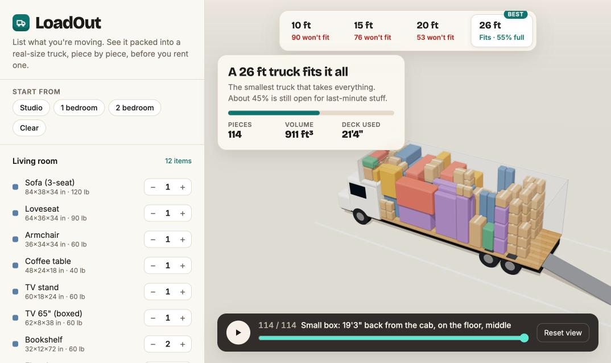
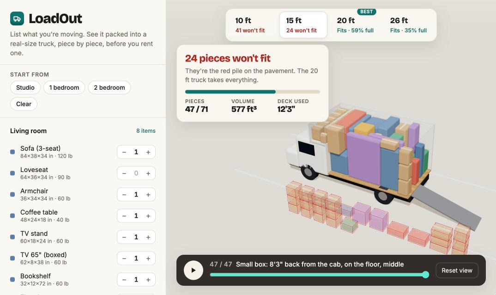

# LoadOut

**Know what size moving truck you need before you rent one.** List what you're moving, and LoadOut packs it into a real-size 3D truck piece by piece, then tells you the smallest truck that fits and the order to load it.



## Why

Truck-size charts guess from "number of bedrooms". Your move isn't an average: one sectional, a king mattress or a garage full of bins changes the answer. Rent too small and you're making a second trip; rent too big and you pay for empty space and drive a bigger truck than you need.

LoadOut packs **your** items instead of guessing.

## What it does

- **Real truck interiors.** 10, 15, 20 and 26 ft trucks, using U-Haul's published inside dimensions, including the over-cab "attic".
- **Packs like movers do:**
  - Heavy pieces stay on the floor, and tiers build from the cab back, floor to ceiling.
  - Mattresses go on edge, and sofas stand on end when that saves room.
  - Nothing gets stacked on things that can't take weight. Furniture gets padding for moving blankets.
- **Picks the truck.** It packs every size and badges the smallest one that takes everything. Anything that doesn't fit shows up as a red pile on the pavement next to the truck.
- **Moving-day instructions.** A step-by-step loading order you can play, scrub or hover, in plain words: *"Dresser: against the cab wall, on the floor, driver side."*
- **Your stuff, not a template.** 37 common items, Studio / 1-bed / 2-bed starting points, and custom items with your own measurements.
- **Private.** Everything runs in your browser. Nothing is uploaded, and your list is saved locally.



## Run it

No build step and no dependencies (three.js loads from a CDN). You need Node 18+.

```bash
npm start            # serves http://127.0.0.1:5178
```

Any static file server works too, since it's just `index.html` and ES modules.

```bash
npm test             # packing engine tests (node --test)
```

## How the packing works

`js/packer.js` is a pure, DOM-free extreme-point packer:

1. **Candidate spots.** These are the corners of everything placed so far, slid back against walls and items.
2. **Rules.** A spot is skipped if the piece would:
   - stick out of the truck;
   - hit another piece;
   - rest less than 70% on something solid;
   - sit on something that can't be stacked on;
   - lift an item of 100 lb or more off the floor.
3. **Choosing a spot.** Of the valid spots, it takes the first one in this order of preference:
   - nearest the cab;
   - least dead space trapped above something nothing may sit on;
   - thinnest tier;
   - lowest, with heavy pieces strongly preferring low;
   - driver side.
4. **Retries.** It tries four loading orders (volume, footprint, height, weight), keeps the one that leaves the least behind, and gives leftovers a second pass.
5. **Attic first.** Light, small things fill the over-cab attic before the deck.

A 2-bedroom move (114 pieces) packed into all four trucks takes about 150 ms.

## Limits

- **Items are boxes.** Each piece is treated as its outer size, so measure the widest points.
- **Not modeled:** wheel wells, tie-down rails and ramp storage. Trucks also vary a little by model year.
- **It's a heuristic.** A patient human can sometimes beat it, so treat "1–2 boxes won't fit" as a coin flip.

Not affiliated with U-Haul; truck sizes come from their published specs.

Vibe coded with Claude Code.
